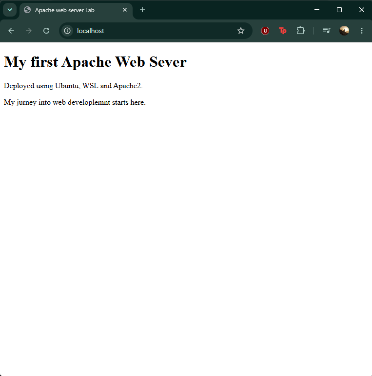

# Apache Web Server Deployment Lab

A hands-on project exploring how to install, configure and deploy a static website using Apache HTTP Server on Ubuntu through Windows Subsystem for Linux (WSL).

## Technologies Used

- **Apache2** – HTTP web server
- **Ubuntu 26.04** – Linux environment
- **WSL** – Windows Subsystem for Linux
- **HTML5** – Web page structure
- **Visual Studio Code** – Code editor
- **Git & GitHub** – Version control

## Project Overview

The goal of this project is to understand how web servers work and gain practical experience deploying a static website in a Linux environment.
## Screenshot


## Installation and Deployment

**1. Update Ubuntu**

```bash
sudo apt update && sudo apt upgrade -y
```

**2. Install Apache**

```bash
sudo apt install apache2 -y
```

**3. Start the Apache service**

```bash
sudo service apache2 start
```

**4. Check the server status**

```bash
sudo service apache2 status
```

**5. Deploy the HTML page**

From the project directory:

```bash
sudo cp index.html /var/www/html/index.html
```

**6. Access the website**

Open `http://localhost` in your browser.

## What I Learned

- Installing and configuring Apache on Ubuntu
- Understanding the client-server model
- Working with Linux terminal commands
- Deploying HTML files to a web server
- Using Git for version control
- Publishing projects on GitHub

## Future Improvements

- Add CSS styling
- Create interactive features with JavaScript
- Explore Apache virtual hosts
- Learn more about server configuration and deployment

## Author

Paula – Web Application Development Student
